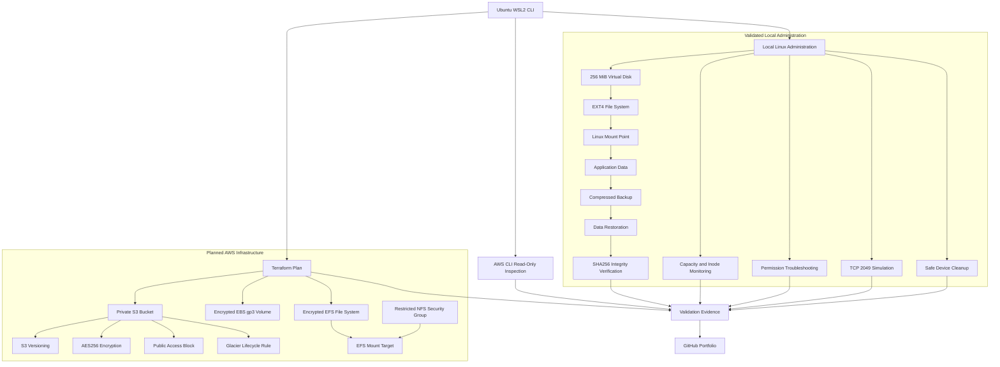
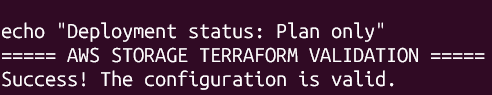
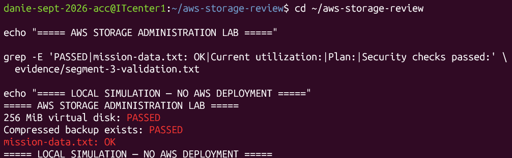

# AWS Storage Engineering Portfolio

## Project Overview

This project demonstrates AWS storage infrastructure design,
Terraform Infrastructure as Code, Linux storage administration,
cloud security, backup and recovery, and operational troubleshooting.

The project combines read-only AWS CLI inspection, Terraform
infrastructure planning, and successfully validated local
Linux administration exercises.

## Technologies

- Amazon S3
- Amazon EBS
- Amazon EFS
- S3 Glacier Flexible Retrieval
- Terraform
- AWS CLI
- Ubuntu WSL2
- Linux EXT4
- Bash and Python
- Git and GitHub

## Architecture



## AWS Infrastructure Design

| Component | Planned Configuration |
|---|---|
| S3 bucket | Private bucket |
| S3 encryption | SSE-S3 AES256 |
| S3 versioning | Enabled |
| S3 public access | All four block settings enabled |
| S3 lifecycle | Eligible current objects transition to Glacier after 90 days |
| EBS volume | 8 GiB encrypted gp3 |
| EFS file system | Encryption at rest enabled |
| EFS throughput | Elastic |
| EFS mount target | Selected default VPC subnet |
| NFS security group | TCP 2049 restricted to selected subnet CIDR |

The design uses an existing default VPC and subnet.
It does not provision a dedicated private VPC.

## Terraform Validation Results

- Terraform formatting: PASSED
- Terraform configuration validation: PASSED
- Resources planned for creation: 9
- Resources planned for modification: 0
- Resources planned for destruction: 0
- Planned security checks: 13/13 PASSED

These results describe a validated infrastructure plan,
not deployed AWS infrastructure.

## Verified Local Administration Results

| Exercise | Result |
|---|---|
| 256 MiB virtual disk | PASSED |
| EXT4 file system administration | PASSED |
| Compressed backup creation | PASSED |
| SHA-256 data integrity | PASSED |
| Permission failure simulation | PASSED |
| Permission remediation | PASSED |
| Directory utilization inspection | PASSED |
| Storage capacity monitoring | HEALTHY - 1% utilization |
| TCP 2049 connectivity simulation | PASSED |
| Data persistence after remount | PASSED |
| Backup restoration | PASSED |
| File system unmounting | PASSED |
| Loop device detachment | PASSED |

## Troubleshooting and Root-Cause Analysis

### Protected EXT4 Recovery Directory

An automated monitoring script stopped because an ordinary
user could not inspect the protected lost+found directory.

The issue was resolved using appropriate administrative
privileges without weakening directory permissions.

### File Permission Troubleshooting

A controlled permission failure was simulated using chmod 000.

Owner-only read and write permissions were restored using
chmod 600, and application file access was verified.

### Loop Device Cleanup

An initial cleanup check reported an attached loop device
immediately after detachment.

The corrective procedure allowed time for device cleanup
and verified successful unmounting and detachment.

### Outcome

All final local administration validation sections completed
successfully without reformatting the existing virtual disk
or losing application data.

## Backup and Recovery

The project demonstrated compressed backup creation,
controlled file restoration, and SHA-256 verification.

Matching checksums confirmed that restored file contents
matched the original application data.

This local exercise does not establish production disaster
recovery readiness or off-site backup resilience.

## Execution Evidence

### Terraform Validation



### Linux Storage Administration



[Verified portfolio evidence](evidence/portfolio/validation-summary.txt)

## Operational Runbooks

- [Storage troubleshooting](docs/storage-troubleshooting.md)
- [Backup and recovery](docs/backup-recovery.md)
- [Security and cost considerations](docs/security-cost-review.md)

## Deployment Status

| Component | Status |
|---|---|
| AWS S3 infrastructure | Planned and validated |
| AWS EBS infrastructure | Planned and validated |
| AWS EFS infrastructure | Planned and validated |
| Glacier lifecycle configuration | Planned and validated |
| Existing AWS inventory | Read-only inspection |
| Local storage administration | Successfully tested |
| Local backup and recovery | Successfully tested |
| Local TCP connectivity | Successfully tested |
| Actual AWS EFS mount | Not performed |
| Terraform apply | Not executed |

## Terraform Usage

```bash
cd terraform
terraform init
terraform fmt -check
terraform validate
terraform plan
```

Review all proposed infrastructure changes before deployment.

Do not execute terraform apply without authorization,
cost review, and an approved deployment decision.

## Security and Cost

The planned infrastructure includes encryption at rest,
S3 public access prevention, versioning, and restricted
NFS connectivity.

Production improvements would include dedicated client
security groups, private network architecture, EFS TLS,
backup policies, monitoring, and runtime security testing.

No new AWS infrastructure was deployed by this project.
Existing AWS resources may continue to incur charges.

## Learning Assessment

| Segment | Score |
|---|---:|
| Storage fundamentals | 9/10 |
| Terraform Infrastructure as Code | 10/10 |
| Administration and troubleshooting | 15/15 |
| Cumulative before final assessment | 34/35 (97.1%) |

## Author

Daniel Korie

AWS Cloud Engineering and Systems Administration Portfolio
